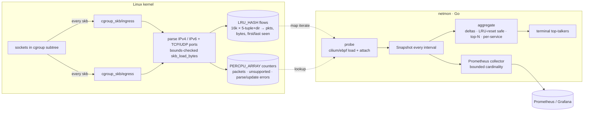

# ebpf-netmon

[](https://github.com/HOFFMAN-ALTERNATIVE/ebpf-netmon/actions/workflows/ci.yml)


**Per-flow network accounting in the kernel, top-talkers in your terminal, Prometheus on the side.**

`ebpf-netmon` attaches two tiny `cgroup_skb` programs (ingress + egress) to a cgroup v2 hierarchy —
the whole host by default — and counts packets and bytes per IPv4/IPv6 5-tuple in an LRU hash map.
Nothing is copied to user space per packet; the Go agent only reads aggregated counters,
so overhead stays flat even under heavy traffic.

Built solo end-to-end: kernel program, ABI contract, Go agent, exporter, and a CI pipeline that
loads the program into a real kernel on every commit.

## Architecture



## Design highlights

- **Observe-only, never drop** — both hooks always return `1`; a monitoring bug can't become an outage.
- **Self-contained BPF C** — only `<linux/bpf.h>`; no libbpf headers, no `vmlinux.h`, builds with any BPF-capable clang.
- **Lock-free hot path** — atomic adds on existing entries, `BPF_NOEXIST` insert with a race fallback, per-CPU health counters.
- **Pinned ABI** — the key/value layout is asserted from three sides: `unsafe.Sizeof`, `binary.Write` vs. the
  hand-written encoder, and the BTF of the *compiled* object (`KeySize=40`, `ValueSize=32`).
- **Correct rates under eviction** — LRU can recycle a flow from zero; deltas detect counter resets instead of wrapping to 2⁶⁴.
- **Bounded Prometheus cardinality** — only the top-N flows and top-M services become series; the rest is folded into totals.
- **Probe health is a metric** — `netmon_probe_events_total{event="parse_error"}` etc., plus `netmon_up`.

## Quick start

```bash
make bpf build                       # needs clang; a prebuilt object is committed too
sudo ./bin/netmon -top 10            # whole host, refresh every 2s, metrics on 127.0.0.1:9435
sudo ./bin/netmon -cgroup /sys/fs/cgroup/system.slice/docker.service   # one subtree only
./bin/netmon -demo                   # synthetic traffic, no privileges
curl -s 127.0.0.1:9435/metrics | grep netmon_
```

```
02:14:07  flows tracked: 5
DIR  PROTO  SOURCE               DESTINATION         RATE          PKT/s  TOTAL
in   tcp    198.51.100.20:443    10.0.0.5:50001      1.6 MiB/s     1225   12.4 MiB
out  tcp    10.0.0.5:50000       192.0.2.10:443      333.1 KiB/s   244    2.5 MiB
out  tcp    10.0.0.5:50004       192.0.2.80:5432     117.4 KiB/s   86     890.2 KiB
```

Requires Linux ≥ 5.8 with cgroup v2 and `CAP_BPF` + `CAP_NET_ADMIN` (or root).

## Testing strategy

| Layer | How | Privileges |
|---|---|---|
| ABI | compiled ELF parsed by cilium/ebpf: map types, key/value sizes, program types, attach points, license | none |
| Decoding | IPv4 (v4-mapped) / IPv6 round trips, raw kernel byte fixtures, short buffers | none |
| Aggregation | rates, idle flows, LRU reset, zero interval, deterministic top-N, per-service grouping | none |
| Exporter | exact exposition via `testutil.CollectAndCompare`, cardinality caps, `netmon_up=0` on failure, metric lint | none |
| CLI | flag validation, end-to-end demo run rendering a real table | none |
| **Kernel** | load through the verifier, attach to the root cgroup, push 1 MiB over loopback, assert both directions counted | root (CI VM via `sudo`) |

Privileged tests live behind the `integration` build tag and skip themselves when not root,
so `go test ./...` is safe anywhere; CI runs them on a disposable GitHub runner.

## License

MIT © Herman Hoffman (the BPF program is dual-licensed MIT/GPL so the kernel accepts it).
