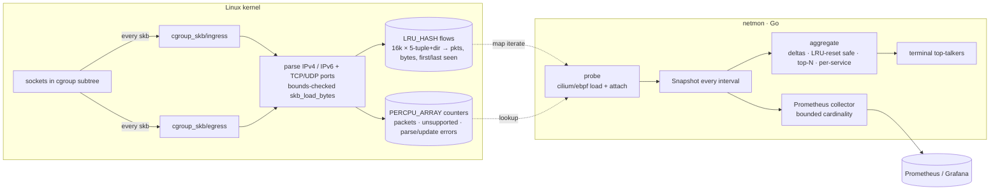

# ebpf-netmon

[](https://github.com/HOFFMAN-ALTERNATIVE/ebpf-netmon/actions/workflows/ci.yml)


See which flows are moving bytes on a Linux host, per IPv4/IPv6 5-tuple, without sniffing packets in user space. Two small `cgroup_skb` programs (ingress and egress) attach to a cgroup v2 hierarchy, the whole host by default, and count packets and bytes in an LRU hash map in the kernel. A Go agent built on cilium/ebpf reads the aggregated counters, prints a top-talkers table and exports bounded-cardinality Prometheus metrics.

Every CI run compiles the BPF object from source, loads it through the verifier on a real kernel, attaches it to the root cgroup, pushes 1 MiB over loopback and asserts both directions were counted.

Per-packet overhead has not been benchmarked yet. The design keeps the hot path to a map lookup and atomic adds, with nothing copied to user space per packet.

## Architecture



## Design highlights

ADRs: [0001 observe-only cgroup_skb hooks](docs/adr/0001-observe-only-cgroup-skb.md), [0002 in-kernel LRU aggregation instead of per-packet events](docs/adr/0002-in-kernel-lru-aggregation.md), [0003 bounded Prometheus cardinality](docs/adr/0003-bounded-metric-cardinality.md).

- **Observe-only, never drop.** Both hooks always return `1`; a monitoring bug can't become an outage.
- **Self-contained BPF C.** Only `<linux/bpf.h>`; no libbpf headers, no `vmlinux.h`, builds with any BPF-capable clang.
- **Lock-free hot path.** Atomic adds on existing entries, `BPF_NOEXIST` insert with a race fallback, per-CPU health counters.
- **Pinned ABI.** The key/value layout is asserted from three sides: `unsafe.Sizeof`, `binary.Write` vs. the
  hand-written encoder, and the BTF of the *compiled* object (`KeySize=40`, `ValueSize=32`).
- **Correct rates under eviction.** LRU can recycle a flow from zero; deltas detect counter resets instead of wrapping to 2⁶⁴.
- **Bounded Prometheus cardinality.** Only the top-N flows and top-M services become series; the rest is folded into totals.
- **Probe health is a metric.** `netmon_probe_events_total{event="parse_error"}` etc., plus `netmon_up`.

## Quick start

```bash
make bpf build                       # needs clang; a prebuilt object is committed too
sudo ./bin/netmon -top 10            # whole host, refresh every 2s, metrics on 127.0.0.1:9435
sudo ./bin/netmon -cgroup /sys/fs/cgroup/system.slice/docker.service   # one subtree only
./bin/netmon -demo                   # synthetic traffic, no privileges
curl -s 127.0.0.1:9435/metrics | grep netmon_
```

```
02:14:07  flows tracked: 5
DIR  PROTO  SOURCE               DESTINATION         RATE          PKT/s  TOTAL
in   tcp    198.51.100.20:443    10.0.0.5:50001      1.6 MiB/s     1225   12.4 MiB
out  tcp    10.0.0.5:50000       192.0.2.10:443      333.1 KiB/s   244    2.5 MiB
out  tcp    10.0.0.5:50004       192.0.2.80:5432     117.4 KiB/s   86     890.2 KiB
```

Requires Linux ≥ 5.8 with cgroup v2 and `CAP_BPF` + `CAP_NET_ADMIN` (or root).

## Testing strategy

| Layer | How | Privileges |
|---|---|---|
| ABI | compiled ELF parsed by cilium/ebpf: map types, key/value sizes, program types, attach points, license | none |
| Decoding | IPv4 (v4-mapped) / IPv6 round trips, raw kernel byte fixtures, short buffers | none |
| Aggregation | rates, idle flows, LRU reset, zero interval, deterministic top-N, per-service grouping | none |
| Exporter | exact exposition via `testutil.CollectAndCompare`, cardinality caps, `netmon_up=0` on failure, metric lint | none |
| CLI | flag validation, end-to-end demo run rendering a real table | none |
| **Kernel** | load through the verifier, attach to the root cgroup, push 1 MiB over loopback, assert both directions counted | root (CI VM via `sudo`) |

Privileged tests live behind the `integration` build tag and skip themselves when not root,
so `go test ./...` is safe anywhere; CI runs them on a disposable GitHub runner.

## Limits

- Counts only traffic of sockets inside the attached cgroup subtree. Forwarded or bridged traffic that never touches a local socket (routers, some CNI setups) is invisible; that needs a TC or XDP hook.
- The flow map holds 16k entries. Under more concurrent flows the LRU evicts the oldest, so long-tail flows can be undercounted; rates stay correct for the flows that remain.
- Ports are parsed for TCP and UDP only. Other IP protocols are counted per address pair with port 0, non-IP frames as `unsupported`, and IPv6 extension headers are not walked.
- No per-process or per-container attribution beyond the cgroup you attach to.
- Needs Linux 5.8+, cgroup v2, `CAP_BPF` and `CAP_NET_ADMIN`. No container image is published, because running it in a container means granting those capabilities anyway.

## Operations

- Metrics and `/healthz` listen on `127.0.0.1:9435` by default; exposing them is an explicit choice (`-listen`).
- SIGTERM stops the refresh loop, lets an in-flight scrape finish (5 s), then detaches the programs and closes the maps.
- Metrics server timeouts: 5 s read header, 10 s read and write, 60 s idle.

Threat model and reporting: [SECURITY.md](SECURITY.md).

## License

MIT (the BPF program is dual-licensed MIT/GPL so the kernel accepts it).
